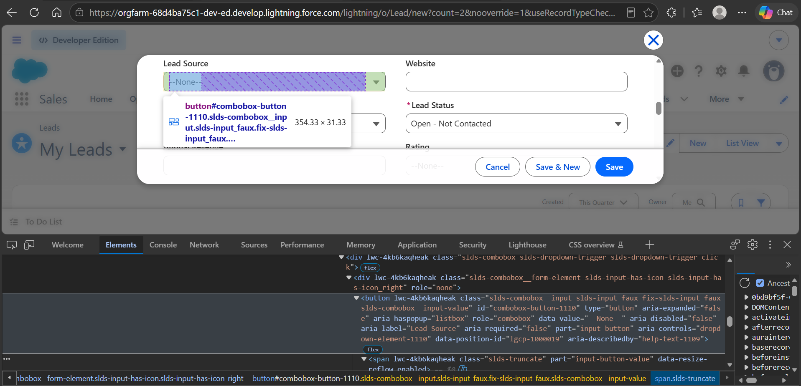

# Notes

Companion to the README: the Part C answers, the API discovery notes for the conversion call, and a short debugging log.

Everything below comes from real runs against my dev org.

---

## Part C.a - Shadow DOM / dynamic component evidence

**Element:** the *Lead Source* picklist in the New Lead form (`lightning-combobox`, rendered inside the modal).

### What the DOM looks like

Screenshot of the element in DevTools: `docs/evidence/lead-source-combobox-devtools.png`



### Why the naive locator doesn't hold up

The things a plain `page.locator(...)` / CSS / XPath approach runs into with this component (measured, see the table below):

- The picklist is not a `<select>`. It is a `<button role="combobox">` inside a chain of `lightning-combobox > lightning-base-combobox > ...` shadow roots, and the option list is another shadow tree under it.
- Its `id`, `aria-controls` and the label wiring are generated at render time (`combobox-button-<n>`, `dropdown-element-<n>`), so an id or `#id` based selector breaks the next time the modal is opened.
- XPath is no help either. I expected it to stop at shadow boundaries, but in the Playwright version I use (1.64) `//button[@role="combobox"]` does reach into them, and then matches every picklist on the form (7), not just this one.

**Seen in my org.** The ids really do change. The option rows of the picklists in three different runs of the New Lead form had `id="combobox-button-496-1-496"`, `id="combobox-button-669-15-669"` and `id="combobox-button-709-3-709"` (copied from Playwright's call log; the `lwc-xxxxxxxxxxx` attributes next to them are generated too). A selector built on any of them would have matched once.

What the obvious locators do on the Lead Source picklist of the New Lead form, tried with a small throwaway script against my dev org (it opens the form and cancels, nothing is saved):

| locator | result |
|---|---|
| `[id="combobox-button-851"]` (the id seen in DevTools) | 1 match, so it works once |
| same id after cancelling and opening the form again | **0 matches**: the id became `combobox-button-852`. Opening it three more times without a reload gave `-1111`, `-1289` and `-1467` |
| `select[name="LeadSource"]`, or any `select` on the page | 0 matches: it is not a `<select>` |
| `button[role="combobox"]` (css) | 7 matches. `.click()` fails with a **strict mode violation** ("resolved to 7 elements") |
| `//button[@role="combobox"]` (xpath) | 7 matches, same problem |
| `getByRole('combobox', { name: /Lead Source/i })` | 1 match, every time |

The element itself, read from the page: a `button` with `role="combobox"`, `id="combobox-button-851"` and `aria-controls="dropdown-element-851"`. Every ancestor on the way up, `lightning-base-combobox`, `lightning-combobox`, `lightning-picklist`, `records-form-picklist`, `records-record-picklist` and `records-record-layout-item`, sits inside a shadow root.

### Locator strategy I used instead

```ts
// src/pages/components/LightningCombobox.ts
trigger(label)  -> scope.getByRole('combobox', { name: /Lead Source/i })
option(value)   -> scope.getByRole('option', { name: /^\s*Web\s*$/i })
                   .or(scope.locator('[role="option"][data-value="Web"]'))
```

Why it is stable: it only uses the role and the accessible name, which is the public accessibility contract of the component and is exactly what a user (or screen reader) sees, so it does not care how many shadow roots sit in between or what ids were generated this time. Playwright resolves role locators through open shadow roots by default, and the option lookup has a second path through `data-value`, which `lightning-base-combobox-item` puts on every row, so a change in either the label text wiring or the option markup doesn't take it down by itself. If the option isn't found, the helper reports which options *were* on screen, which turns "wrong picklist value for this org" from a mystery into a one-line fix.

### Second example (detail view fields)

Fields on the record page are read with `[data-target-selection-name="sfdc:RecordField.Lead.Company"]` (field API name stamped by Lightning on the wrapper), with `records-record-layout-item[field-label="..."]` as a fallback. The API name survives layout changes and translated labels, which a text based locator would not.

---

## Part B - API / response discovery (Lead -> Opportunity conversion)

### How the call is captured

`src/api/conversionCapture.ts` registers `page.waitForResponse(...)` *before* clicking Convert. Lightning sends most requests as `POST .../aura?...` where one URL carries many actions, so the URL is no use for identification. The matcher is: POST to `/aura` whose body has an action descriptor containing `convertLead` (or a `/services/data/` url that mentions `convert`). My first version accepted any `/aura` body that mentioned the word "convert", and one run attached Lightning's telemetry call (`InstrumentationBeaconController/ACTION$sendData`, sent when the Convert button is clicked) instead of the conversion, so the response check failed for no good reason. Matching on the descriptor fixed it. The response JSON is parsed (stripping the occasional `while(1);` / `/*ERROR*/` prefix) and attached to the test report as `convert-response.json`, along with the decoded request as `convert-request.txt` and the discovered paths as `convert-json-paths.json`.

### What is asserted

`src/api/conversionAssertions.ts`:

1. HTTP status is 200.
2. For an Aura response, every action that carries the new opportunity id has `state === "SUCCESS"`.
3. Deep properties, searched by value anywhere in the payload and compared with what the UI reported:
   - an Opportunity id (`006` + 15 chars) exists and **equals** the id of the opportunity the UI navigates to
   - the Account id (`001...`) equals the account the modal linked (the seeded one in the "existing" branches)
   - the Contact id (`003...`) equals the contact the modal linked

The ids are searched for by value instead of by hard-coded path because the Aura payload shape isn't documented; the path where each one was found is written to `convert-json-paths.json`. After looking at real runs the three locations are pinned (the table below), with the action index left open because Lightning can batch other actions into the same call.

### What I observed

From the conversion scenarios of my dev org (same result in all three branches):

| item | observed |
|---|---|
| endpoint | `POST https://<org>.develop.lightning.force.com/aura?...`, HTTP 200 |
| action descriptor in the request | `serviceComponent://ui.lead.runtime.components.controllers.LeadConvertDesktopController/ACTION$convertLeadServer` |
| request params | `leadId`, plus `newAccountRecord` (an Account sobject) or `existingAccountId`; the same split for the contact (`newContactRecord` / existing id). So the request itself shows which branch the modal took |
| path of the opportunity id | `$.actions[0].returnValue.opportunityId` |
| path of the account id | `$.actions[0].returnValue.accountId` |
| path of the contact id | `$.actions[0].returnValue.contactId` |
| stage / status field in the payload | none. The payload carries ids only, so the opportunity stage can only be checked on the record page, which the test does |

The ids in the response equal the ids the confirmation dialog showed, and the "existing" branches return the ids of the existing records. `assertConversionResponse` now also checks that the three ids sit at those paths.

---|---|
> | endpoint | `POST ...` |
> | action descriptor in the request | `...` |
> | path of the opportunity id | `$.actions[0]...` |
> | path of the account id | `$...` |
> | path of the contact id | `$...` |
> | stage / status field in the payload (if any) and its value | `...` |
>
> Then pin the two or three paths above in `assertConversionResponse` so the assertion is on a known location, not a search.

---

## Known fragile spots

These are the parts of the Lightning UI I expect to move between releases, so they are kept in one place each:

| area | where |
|---|---|
| conversion modal markup (existing vs new lookups, confirmation dialog) | `LeadConvertPage.ts` |
| validation / duplicate banner wording | `LeadPage.ts` (`validationSummary`, `duplicateAlert`) |
| login + verification page elements | `LoginPage.ts` |
| picklists | `LightningCombobox.ts` |
| lookups (search-all row, dropdown that closes) | `LightningLookup.ts` |
| shared Account / Contact and how long search takes to see them | `sharedData.ts`, `shared-data.setup.ts` |

---

## Debugging log

What actually broke while getting this to run against a real org, in the order it happened. Each row was found from the failure artefacts (screenshot, `error-context.md` page snapshot, call log, `logs/run.log`). The change history is in the git log.

| what broke | how I found out | fix | where |
|---|---|---|---|
| `npm run test:fresh-login`: `'RUN_FRESH_LOGIN' is not recognized` | terminal output. Inline `VAR=1 cmd` is bash syntax, I run on Windows | `cross-env` in the two scripts that set a variable | `package.json` |
| Login timed out waiting for `#password` | screenshot: the page only had a Username field and a Log In button, the password comes after the first click (username-first login). The "Access Denied" panel beside it is a promo iframe, unrelated | click Log In / Continue first when the password field is not there | `LoginPage.ts` |
| "No verification code arrived" after 90 s, but no IMAP error | screenshot of the verification page: "Enter the verification code we **texted** to +** ****1164". The user has a verified mobile number, so nothing is emailed. IMAP itself was fine (no auth error in the log) | removed the mobile number from the user in the org, after which the log showed the mail found in INBOX. Also made a bad app password fail immediately with a clear message | org setup, `mail.ts` |
| Saving a lead timed out, although the lead existed | the url in the error was `/lightning/r/00Q.../view`: this org leaves the object name out | object segment optional in the saved-url checks and in `recordIdFromUrl` | `LeadPage.ts`, `BasePage.ts` |
| Missing-field tests counted 0 "Complete this field." errors | screenshot showed the errors clearly on screen; the page snapshot listed only `dialog "We hit a snag."`. While that popover is open Lightning drops the form from the accessibility tree, so role locators can't see it. The summary also lists the compound field as **Name**, not "Last Name" | text / css locators for the form, inline errors and Cancel while a popover is open; expect the "Name" link | `LeadPage.ts`, `negative.spec.ts` |
| Duplicate test: picklist option "not visible" | screenshot: the "Similar Records Exist" popover was already open mid-fill. This org runs the duplicate check live, and the popover closes any dropdown being opened | the test fills only the fields the rule watches; picklists are filled before text fields; `save()` doesn't click when the alert is already showing | `negative.spec.ts`, `LeadPage.ts` |
| Picklists near the bottom of the modal: option "element is not visible" | Playwright's call log: the option resolved, then "scrolling into view", then not visible. Scrolling the modal closes the dropdown | centre the picklist in the modal before opening it | `LightningCombobox.ts` |
| Convert modal: "Account Name" lookup not found | screenshot of the modal: it is radio based (Create New / Choose Existing + an "Account Search" box), not a single lookup. `check()` on a disabled radio changed nothing; a toast also sat over the radios | rewrote the account / contact step around the radios and the search box; native click on the radio | `LeadConvertPage.ts` |
| A brand-new company was reported as "existing" and the contact seeder opened Advanced Search | rows logged from the dropdown: `Search for matching accounts "..." in Account`. It contains the name but is a search-all row, not a record | shared row filter, and the seeder only accepts rows that start with the record's name | `LightningLookup.ts` |
| `strict mode violation` on the "Your lead has been converted" dialog | error listed two dialogs: the old Convert Lead modal (still in the DOM, same sentence) and the confirmation | find it by accessible name | `LeadConvertPage.ts` |
| Response check failed on one scenario: "an aura action should carry the new opportunity id" | the attached request was `InstrumentationBeaconController/ACTION$sendData`, telemetry that also mentions "convert" | match the `convertLead` action descriptor | `conversionCapture.ts` |
| Contact page: Account Name field not found | the contact page never opened the Details tab (lead and opportunity pages did) | shared `openDetailsTab` in the base page | `BasePage.ts`, `ContactPage.ts` |
| "Account exists" scenarios randomly picked "new" | log: an account seeded at 12:57:19 was searched for from 12:58:23 to 12:59:20, 10 attempts, never found. Another one seeded at 12:30:08 was found 49 s later. The modal finds records through the search index, which lagged 45 s to over 2 min | one shared Account / Contact created once and reused; only the first run waits for the index | `sharedData.ts`, `shared-data.setup.ts`, `leadConversion.spec.ts` |
| Shared-data setup failed, then "1 passed" and everything else skipped | the setup test's error: the Account Name lookup showed no rows for the account created seconds earlier. Dependent projects are skipped when a setup project fails. It had also left an account behind with no saved id | open New Contact with the account preset (`defaultFieldValues`), verify the link afterwards, save each id as soon as it exists | `RecordSeeder.ts`, `shared-data.setup.ts` |
| First lead of the duplicate test "hit a duplicate alert" although it saved | screenshot showed the saved lead record; the alert had flashed up just as the save went through, then a second Save click hit a detached button | after an alert, a url change to the new record wins | `LeadPage.ts` |
| Lookup click timed out although the row had been listed | screenshot: typed text left in the field, flagged invalid, no dropdown. The list closed between reading it and clicking | on a failed click, search again and retry | `LightningLookup.ts` |
| WebKit smoke: click on "New" still "in progress" after 15 s | call log stopped at "performing click action"; the screenshot showed the dimmed page with the modal not painted yet. Only happened in WebKit | longer action / expect timeouts for the webkit project | `playwright.config.ts` |
