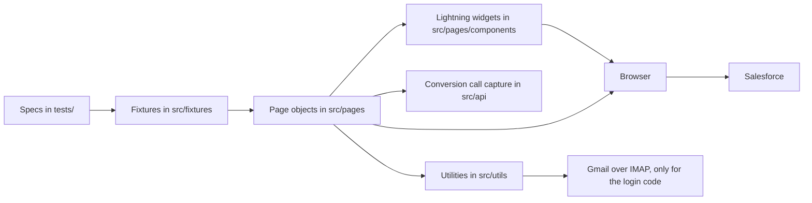
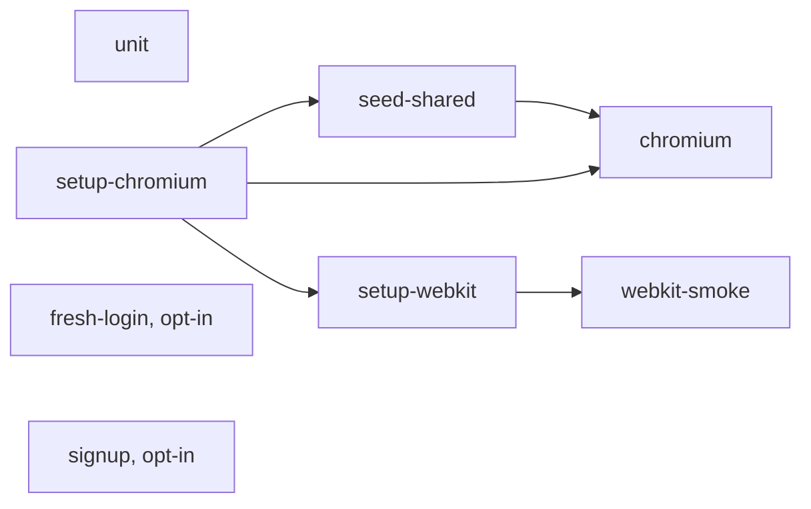
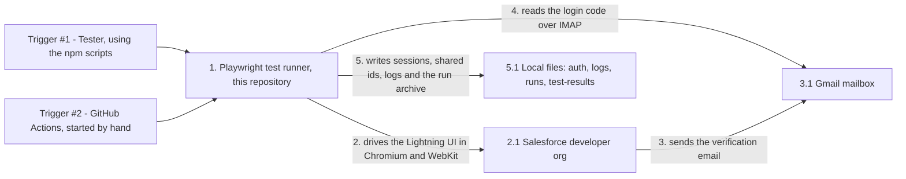
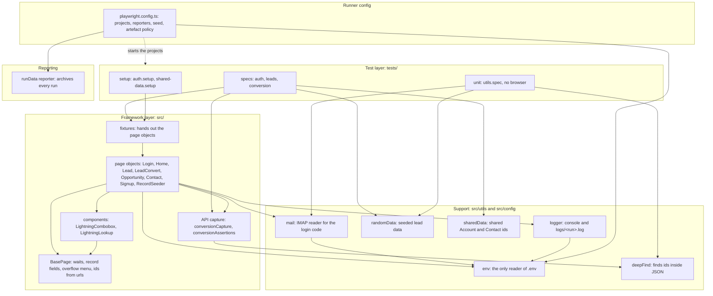
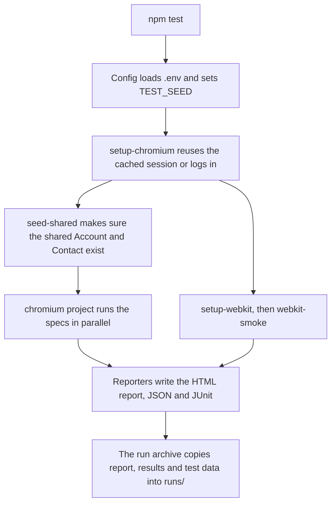
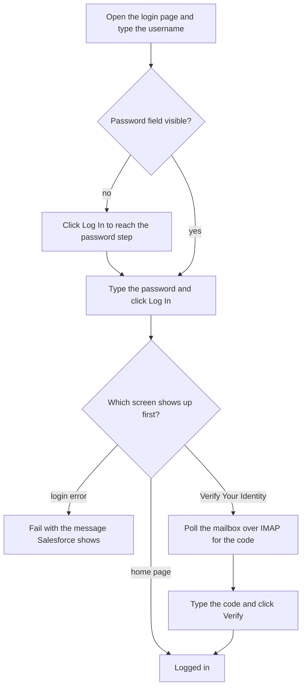

# Architecture

How the framework is put together, in which order a run happens, and where the results go. The README covers setup and usage; [NOTES.md](../NOTES.md) holds the evidence and the debugging log.

## Layers

A spec describes behaviour and never contains a locator. Locators and Salesforce-specific waits live in page objects, so a markup change in Salesforce is fixed in one place.



| folder | responsibility |
|---|---|
| `tests/` | specs and setup files, grouped by feature (see below) |
| `src/fixtures` | hands page objects to the specs as fixtures (`home`, `leads`, `convert`, ...) |
| `src/pages` | one page object per page or area, plus `BasePage` for the shared waits and record-field locators |
| `src/pages/components` | reusable Lightning widgets that need care: `LightningCombobox`, `LightningLookup` |
| `src/api` | catches the conversion request and asserts on its response |
| `src/utils` | logger, seeded random data, shared Account / Contact helper, mail reader, JSON helpers |
| `src/config` | the only place that reads environment values |
| `src/reporters` | the reporter that archives every run |

## Test layout and tags

```
tests/
  setup/        auth.setup.ts, shared-data.setup.ts     run first, produce the session and the shared records
  auth/         login.spec.ts, fresh-login.spec.ts, signup.spec.ts
  leads/        lead.spec.ts, leadData.spec.ts, negative.spec.ts
  conversion/   leadConversion.spec.ts
  unit/         utils.spec.ts                            offline, no browser, no org
```

Tags are set on the `describe` block with Playwright's `{ tag: [...] }` option: `@smoke`, `@regression`, `@negative`, `@data`. The README has the table and the npm scripts that select them.

## Projects and order

Playwright projects decide what runs in which order. A project starts only after the projects it depends on have passed, and if one fails, everything behind it is skipped.



`setup-webkit` waits for `setup-chromium` on purpose: two logins at the same time would ask for two verification codes, and the mailbox reader could hand one browser the other's code.

## Component diagrams

Two views of the same system: who talks to whom from the outside, and how the code inside is divided.

### System context



Four things sit around the framework: the Salesforce org it drives, the Gmail mailbox it reads the login code from, the local folders it writes to, and GitHub Actions, which only starts it by hand.

### Components inside the framework



| component | what it is responsible for | files |
|---|---|---|
| Specs | behaviour only, written with `test.step`, no locators | `tests/auth`, `tests/leads`, `tests/conversion` |
| Setup | produce the session and the shared records before anything else runs | `tests/setup` |
| Fixtures | give each test its page objects | `src/fixtures/index.ts` |
| Page objects | everything Salesforce-specific: locators, waits, outcomes | `src/pages` |
| BasePage | the helpers every page needs: idle wait, record fields, overflow menu, ids from urls | `src/pages/BasePage.ts` |
| Components | the two widgets that need special care (picklist, lookup) | `src/pages/components` |
| API capture | catches the conversion call and checks its response | `src/api` |
| Support | config, logging, data, mail, JSON search | `src/config`, `src/utils` |
| Reporting | archives every run | `src/reporters/runData.ts` |
| Runner config | which projects run, in what order, with which artefact policy | `playwright.config.ts` |

---

## A run, step by step



### Login and the verification code

The cached session is never trusted on its own: it is proven by opening the org. When a login is needed, it waits for whichever screen comes next, so it works whether or not Salesforce asks for a code.



The code can only be read when it is sent by email. A user with a verified mobile number gets an SMS instead, which the framework cannot see.

## Data

- **The lead under test** is created through the UI, because creating it is the behaviour being tested. Names, company and email carry a unique suffix, and the random picks come from a seeded generator, so a run can be replayed with `TEST_SEED`.
- **The "already exists" records** are one shared Account and Contact, created once by `seed-shared` and kept in `auth/shared-data.json`. Records created seconds earlier are not yet searchable (45 s to over 2 minutes were measured), and the Convert Lead modal finds existing records through search.
- **Everything created** carries the `QA_AUTO` prefix so leftovers are easy to find and delete. There is no automatic cleanup yet.

## Where results go

| what | where | replaced by the next run |
|---|---|---|
| Latest HTML report | `playwright-report/` | yes |
| Latest screenshots, videos, traces, JUnit and JSON | `test-results/` | yes |
| Every run, with the data each test used | `runs/<start time>_seed<seed>/`, indexed in `runs/index.csv` | no |
| Timestamped worker log, one file per run (copied into the run folder as `run.log`) | `logs/<start time>_seed<seed>.log` | no |
| Cached sessions and the shared record ids | `auth/` | when the login is redone |

By default every test keeps a screenshot, a video and a trace; `ARTIFACTS=failures` keeps them only for failures. The two login tests never record a trace, because a trace stores typed values and request bodies.

## Design decisions in short

| decision | why | detail |
|---|---|---|
| Setup projects instead of a global setup | they show up in the report and in traces, and a failed setup skips what depends on it | `playwright.config.ts` |
| Role plus accessible name for locators | generated ids change on every open, and CSS or XPath match every picklist on the form | NOTES.md, Part C.a |
| Real mailbox over IMAP for the login code | tests the real login path with no org changes | README, "Email verification code on login" |
| One shared Account and Contact | search lags behind creation | README, "Test data strategy" |
| Retry open-and-click as one unit | Lightning re-renders and closes menus and dropdowns | NOTES.md, debugging log |
| Archive every run | Playwright empties `test-results/` at the start of each run | README, "Keeping earlier runs" |
